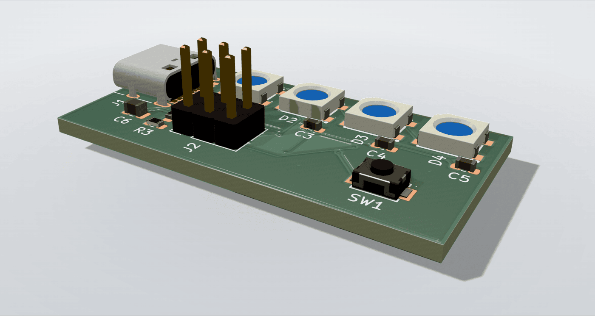
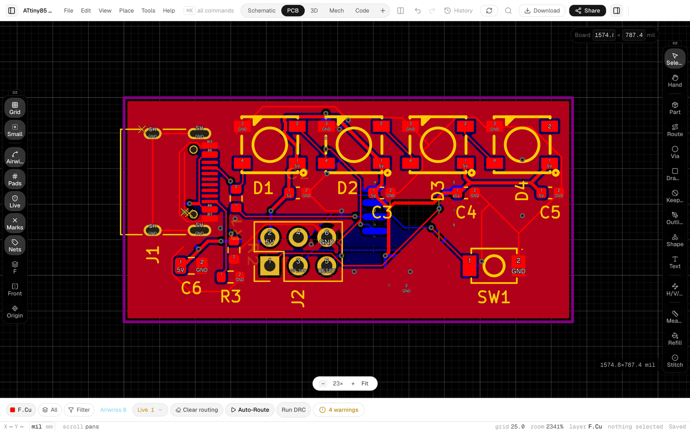
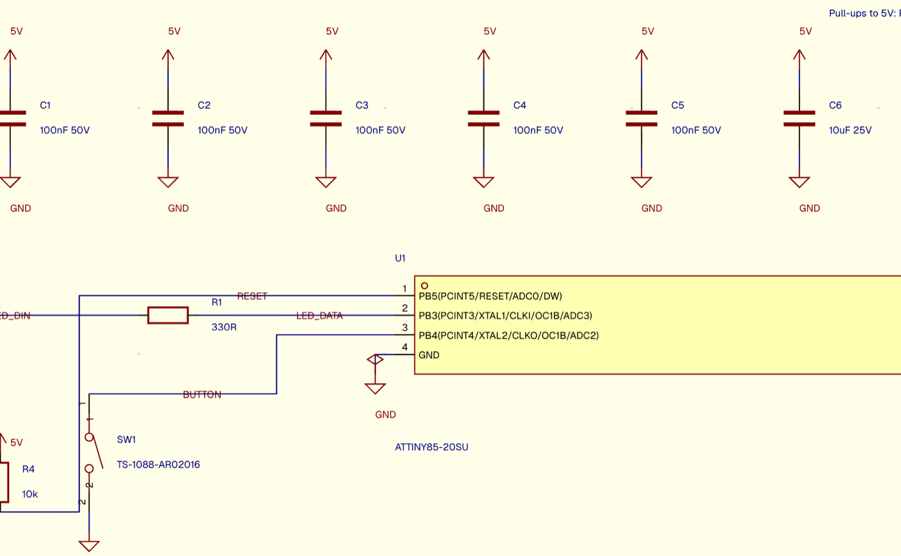
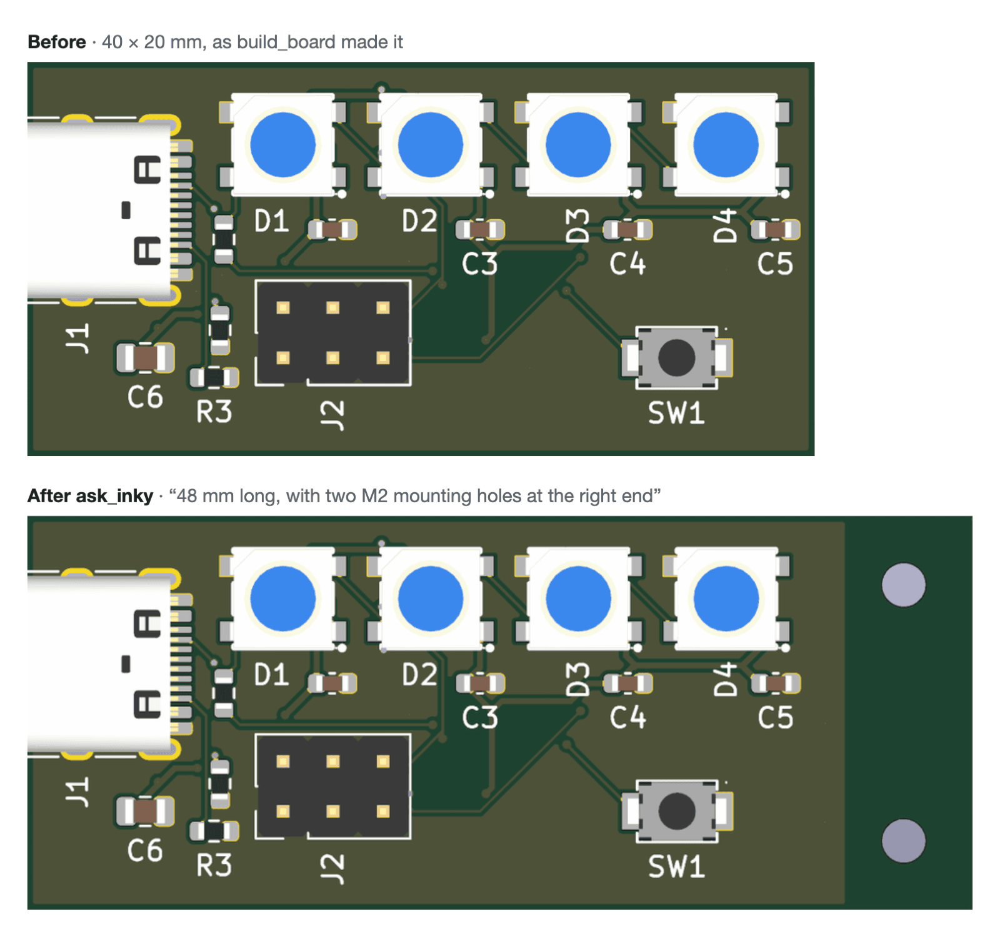
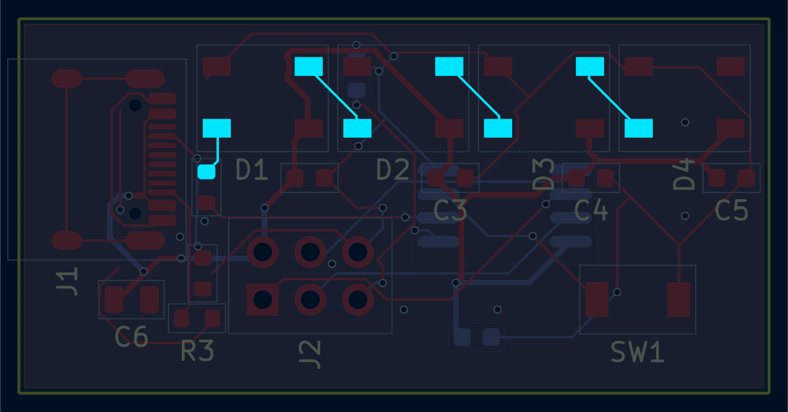

# @heypcb/mcp

<p align="center">
  
</p>
<p align="center"><sub>Built from Claude Code with <code>build_board</code>: one brief in, a board ready to order out (all 15 fab checks passed; 4 DRC warnings left).</sub></p>

HeyPCB for AI agents. Add HeyPCB to Claude Code, Codex, Cursor or Claude
Desktop and design real KiCad boards from your agent: HeyPCB's server does
the engineering (Inky's design agent, parts, placement, routing, DRC/ERC,
fab checks), and your agent calls a few high-level tools such as
`build_board`, `get_board`, `check_board` and `export`. Or your agent
designs the board itself with HeyPCB's parts library, proven circuit blocks
and checks: `search_parts`, `get_part`, `add_parts`, `add_block`, `connect`,
`get_netlist` and the rest of the parts and circuit tools, then lays it out
with `set_board_outline`, `set_board_rules`, `move_part`, `lock_parts`,
`add_ground_pour` and `get_board_layout`, and takes it to fab-ready by
following `check_board`: every finding names the call that fixes it
(`fixWith`). It sees what it built with `preview_board` (chosen layers,
highlighted nets and parts, open connections), measures it with
`inspect_net`, `inspect_part` and `check_placement`, says where parts go with
`set_placement_rules`, controls copper with `rip_up_net`, `add_pour`,
`add_keepout` and `stitch_vias`, goes back through the board's history with
`list_history`, `restore_board` and `redo`, and reads the playbook with
`get_guide`.

## Two ways to design

| | You say | Your agent calls |
|---|---|---|
| **Let HeyPCB design it** | "Build a USB-C powered board for …" | `build_board`, `get_board`, `check_board`, `export`. HeyPCB's server does the engineering: Inky's design agent, parts, placement, routing, DRC/ERC and fab checks. |
| **Let your agent design it** | "Add an LDO and wire it to the MCU" | Parts and blocks: `search_parts`, `get_part`, `add_parts`, `add_block`, `connect`, `get_netlist`. Layout: `set_board_outline`, `set_board_rules`, `move_part`, `lock_parts`, `add_ground_pour`, `get_board_layout`. Then `check_board` until the board is fab-ready. Each finding names the call that fixes it (`fixWith`). |

### On heypcb.ai

The same board in the heypcb.ai editor: the PCB, and the schematic around
the ATtiny85:





### Change it by asking

From Claude Code: the request and Claude's `ask_inky` call, then its
answer once Inky finished. `ask_inky` returns while Inky is still working;
the 7 minutes of `wait_for_turn` calls in between are cut at the dashed
line:


The board before and after, at the same scale:



## Quick start

HeyPCB runs the MCP server for you at `https://api.heypcb.ai/mcp` (Streamable
HTTP, OAuth sign-in in your browser). Nothing to install:

```sh
claude mcp add --transport http heypcb https://api.heypcb.ai/mcp
```

[](https://cursor.com/install-mcp?name=heypcb&config=eyJ1cmwiOiJodHRwczovL2FwaS5oZXlwY2IuYWkvbWNwIn0%3D)

claude.ai (as a custom connector) takes the same URL. Codex cannot sign in
to the remote server (since codex-cli 0.165 it refuses an approve page on
another origin than the issuer), so give Codex the local server below. One
paste adds it and signs it in with a code:

```sh
codex mcp add heypcb -- npx -y @heypcb/mcp && npx -y @heypcb/mcp login
```

### Which one do I need?

| | Remote server | Local server (this package) |
|---|:---:|:---:|
| Install | nothing | Node.js 18+ |
| All HeyPCB tools | ✅ | ✅ |
| Work on a KiCad project in its own folder, edits synced back | ❌ | ✅ `open_kicad_project` |
| Upload a copy of a KiCad project from your disk | ❌ | ✅ `upload_kicad_project` |
| Save Gerbers, BOM, CPL, STEP to a folder | ❌ | ✅ `save_export` |
| HeyPCB parts in the project's own libraries | ❌ | Awaiting the parts-assets API |
| KiCad's own DRC/ERC and exports, free and offline | ❌ | ✅ `check_local`, `export_local` |

Use the remote server unless you use Codex or need one of the local tools.

## Tools

Both servers offer every tool below, with the same names; the local server
adds [its own](#the-local-server-this-package). Each tool's full description
and input schema come from the server itself, so your agent always reads the
current ones.

Seven tools run paid engine work, at what the same work costs on heypcb.ai:
`build_board`, `ask_inky`, `answer_decision`, `check_board`, `route_board`,
`place_parts` and `preview_placement` (`estimate` prices them first). Every
other tool says it is free in its own description; the design and layout
tools are rate-limited.

<details>
<summary><b>Let HeyPCB design it</b></summary>

| Tool | What it does |
|---|---|
| `whoami` | Your HeyPCB account, plan, balance and what can run. |
| `list_projects` | Your HeyPCB boards: id, name, last update, web link. |
| `create_project` | Create an empty HeyPCB board project. |
| `build_board` | Design a whole PCB from a plain-language brief: schematic, parts, placement, routing and checks. |
| `ask_inky` | One turn of Inky, HeyPCB's design agent, on a project: a question or an edit. |
| `wait_for_turn` | Wait for a running Inky turn and return its result. |
| `stop_turn` | Stop a running Inky turn at its next step. |
| `answer_decision` | Answer a decision Inky asked for (for example approve the layout). |
| `get_board` | Board facts: layers, size, parts, nets, routed %, DRC/ERC counts, fab readiness, web link. |
| `get_board_image` | A picture of the PCB (top or bottom), a schematic page or the 3D view. |
| `check_board` | Run DRC, ERC and the placement check, the full verification, or the fab check, with findings. |
| `route_board` | Autoroute the board, or only the nets you name, and return the result. |
| `place_parts` | Re-place the board's parts. |
| `preview_placement` | Plan a re-place on a copy and show it before anything moves. |
| `apply_placement` | Land a previewed placement plan exactly, as one undoable change. |
| `export` | Gerbers, KiCad project, BOM, pick-and-place or STEP as a short-lived download link. |
| `read_design` | Read the design or a schematic/board file's text for inspection. |
| `estimate` | The price of an operation before running it. |

</details>

<details>
<summary><b>Design it yourself: parts and circuit</b></summary>

| Tool | What it does |
|---|---|
| `search_parts` | Find real, orderable parts: LCSC stock and price, verified footprints, KiCad symbols. |
| `get_part` | A part's pins and facts: an LCSC part card, a KiCad symbol's pins, or a part on the board. |
| `add_parts` | Add parts to the board's design; the board places them. |
| `remove_parts` | Delete parts from the design and the board. |
| `set_part_value` | Change one part's value in place. |
| `rename_part` | Rename a designator everywhere: design, nets, schematic and board. |
| `source_parts` | Give every unsourced part an orderable LCSC part. |
| `connect` | Connect pins (REF.PIN) into named nets. |
| `disconnect` | Remove pins from every net they are on. |
| `list_blocks` | HeyPCB's proven circuit blocks (USB-C power, regulators, MCU modules…). |
| `add_block` | Add a proven circuit block to the design. |
| `set_net_class` | Set a net class: width, clearance, current, impedance, differential pairs. |
| `rename_net` | Rename a net. |
| `set_no_connect` | Toggle a no-connect flag on a pin. |
| `get_netlist` | Every net with its pins, class, drivers and current grade. |
| `get_design_summary` | The design in one compact read: parts, nets, counts, unsourced parts. |
| `get_schematic` | One schematic page as text, with the page list. |
| `tidy_schematic` | Re-lay the schematic's hand-placed symbols with HeyPCB's own layout. |
| `get_capable_pins` | Which MCU pins can carry a function (UART, I2C, SPI, PWM…) and are free. |

</details>

<details>
<summary><b>Design it yourself: the board</b></summary>

| Tool | What it does |
|---|---|
| `set_board_outline` | Set the board's outline in mm (rect, rounded, circle, polygon…), with corner mounting holes. |
| `set_board_rules` | Set the copper layers, HDI, metal core or flex, thickness, colours and finish, and the design rules, e.g. JLCPCB's. |
| `move_part` | Move parts on the board: x/y, a shift, beside a pin, against an edge; a routed board keeps its routing. |
| `lock_parts` | Pin parts where they are so place_parts keeps them. |
| `unlock_parts` | Release locked parts. |
| `set_placement_rules` | Say where parts go: edges, locks, caps by a pin, signal chains, rings and grids. |
| `add_ground_pour` | Pour the GND plane once routing is finished. |
| `add_pour` | Pour copper on any net and layer, once routing is finished. |
| `remove_pour` | Take a copper pour off the board. |
| `add_keepout` | Keep an area clear of tracks, vias, pads, pours or parts. |
| `rip_up_net` | Delete a net's tracks and vias so it can be routed again. |
| `stitch_vias` | Stitch a net's pours together with a grid of vias. |
| `tune_lengths` | Match lengths of a bus or a differential pair with meanders, kept only when DRC holds. |
| `add_text` | Write text on the board (silkscreen, copper or mask). |
| `add_mounting_hole` | Put a screw hole (M2–M4) on the board. |
| `tidy_silkscreen` | Re-place every silkscreen designator beside its part, clear of pads and openings. |

</details>

`preview_board` shows your agent what it built. Here it highlights the
LEDs' data chain, from the series resistor through D1 to D4:



<details>
<summary><b>See, measure and go back</b></summary>

| Tool | What it does |
|---|---|
| `get_board_layout` | The layout in one read: outline, layers, rules, every part's place, rotation, side and box. |
| `preview_board` | A CAD view of the board: chosen layers, highlighted nets and parts, open connections, cropped. |
| `inspect_net` | A net measured: status, copper per layer, vias, every open connection pin to pin. |
| `inspect_part` | A part measured: place, edge gaps, neighbours, open pins, the nearest cap to each supply pin. |
| `check_placement` | Grade the placement: decoupling, crystals, connectors at edges; each finding names its fix. |
| `check_routing` | Grade routed copper against pairs, matched lengths and impedance the net classes state. |
| `undo` | Undo the last change to a project. |
| `list_history` | Every change the board can go back through, and what redo can put back. |
| `restore_board` | Put the board back to any point in its history, in one guarded call. |
| `redo` | Put back changes undo or restore_board took back. |
| `save_checkpoint` | Save the whole board under a label, past the 50 changes the history keeps. |
| `delete_checkpoint` | Delete a saved checkpoint. |
| `get_guide` | The playbook for designing a board with these tools yourself. |

</details>

## The local server (this package)

`npx -y @heypcb/mcp` runs a small MCP server on your computer (stdio). It
passes every HeyPCB tool through to the remote server unchanged, with the
same names, schemas, results, progress and cancellation. It has no design
logic of its own. It adds the tools that need your files:

| Tool | What it does |
|---|---|
| `open_kicad_project` | Binds a KiCad project folder on this computer to one HeyPCB project, so every HeyPCB tool works on it and its edits land back in the folder ([see below](#working-on-a-kicad-project-in-its-own-folder)). |
| `upload_kicad_project` | Zips a KiCad project folder on this computer (board, schematic hierarchy, `.kicad_pro`, `.kicad_dru`, library tables and project-local libraries, but not 3D models, backups or `.kicad_prl`; at most 50 MB) and imports it as a new, separate HeyPCB project: a one-off copy. Returns the project id and its web link. |
| `save_export` | Saves Gerbers, the KiCad project, BOM, pick-and-place (CPL) or STEP into a folder here, atomically, and returns the file's path. |
| `install_parts` (not advertised) | Refuses before writing until the server exposes a supported parts-assets API. |
| `check_local` | KiCad's own DRC or ERC on the project here, with `kicad-cli`: free, no network. A fast pre-check; `check_board` stays the full verification. |
| `export_local` | Gerbers (+ drill), BOM, pick-and-place or STEP from the project here, with `kicad-cli`. |
| `restore_local` | Puts back files a sync backed up before HeyPCB's changes replaced them. |

It needs Node.js 18 or newer and nothing else. Everything it uses is bundled
into one file. `check_local` and `export_local` also need KiCad 8 or newer
installed (`kicad-cli` on `PATH`, or in KiCad's standard install folder).

### 1. Sign in (once per computer)

**Option A: sign in with a code**

```sh
npx @heypcb/mcp login
```

It opens heypcb.ai/connect and shows a code; check the page shows the same
code and approve. The sign-in is stored in `~/.config/heypcb/credentials.json`
(`%APPDATA%\heypcb\credentials.json` on Windows), readable only by you. A
running server picks it up on its next call, without a restart.

**Option B: use a personal key**

Make one in **heypcb.ai → Settings → Devices & API keys** and give it to the
server as `HEYPCB_API_KEY` (examples below). A key is used instead of a
stored sign-in while it is set.

> [!TIP]
> Without either, the server still starts, and every tool answers with these
> two ways to sign in.

### 2. Add it to your agent

#### Claude Code

```sh
claude mcp add heypcb -- npx -y @heypcb/mcp
# or with a personal key instead of `login`:
claude mcp add heypcb -e HEYPCB_API_KEY=hpcb_pk_… -- npx -y @heypcb/mcp
```

#### Cursor

[](https://cursor.com/install-mcp?name=heypcb&config=eyJjb21tYW5kIjoibnB4IiwiYXJncyI6WyIteSIsIkBoZXlwY2IvbWNwIl19)

Or add it by hand to `.cursor/mcp.json` in your project (or `~/.cursor/mcp.json`):

```json
{
  "mcpServers": {
    "heypcb": {
      "command": "npx",
      "args": ["-y", "@heypcb/mcp"]
    }
  }
}
```

#### Codex

In `~/.codex/config.toml`:

```toml
[mcp_servers.heypcb]
command = "npx"
args = ["-y", "@heypcb/mcp"]
# env = { HEYPCB_API_KEY = "hpcb_pk_…" }
```

#### Claude Desktop

In `claude_desktop_config.json` (Settings → Developer → Edit Config):

```json
{
  "mcpServers": {
    "heypcb": {
      "command": "npx",
      "args": ["-y", "@heypcb/mcp"],
      "env": { "HEYPCB_API_KEY": "hpcb_pk_…" }
    }
  }
}
```

### 3. Try it

Ask your agent, for example:

- "Upload my KiCad project at `~/boards/sensor` to HeyPCB and run the full check."
- "Save the Gerbers and BOM for that project into `~/boards/sensor/fab`."
- "Open my KiCad project at `~/boards/sensor`, add a 3.3 V LDO and route the board."

### Working on a KiCad project in its own folder

Ask your agent to open the project (`open_kicad_project` with its folder).
The first time, the folder is uploaded as a new HeyPCB project and bound to
it in `.heypcb/workspace.json` (added to `.gitignore` when the folder is in a
git repository). From then on, every HeyPCB tool called on that project
keeps the folder in sync:

- **before a call**, a changed project is uploaded as a complete zip against its last synced revision;
- **after a call that changes the design**, the files HeyPCB changed come
  back. The old ones are copied to `.heypcb/backup/<revision>/` first, and
  the result tells your agent which files to reload in KiCad;
- **a file you save in KiCad while a call runs is never overwritten**:
  HeyPCB's version is written beside it as `<file>.heypcb-new`, and syncing
  waits until you choose (`on_conflict: "take_heypcb"` or `"keep_local"`).
  The same choice resolves an edit made on heypcb.ai and here at once;
- part-library installation is not advertised yet: the current API does not
  serve the required part assets. Direct `install_parts` attempts refuse before writing.

The project stays a normal KiCad project: open it in KiCad at any time.
List files you never want uploaded in a `.heypcbignore` next to the
`.kicad_pro` (one gitignore-style pattern a line).

### Commands

```text
npx -y @heypcb/mcp          run the MCP server on stdio (what your agent runs)
     --max-spend <amount>   block potentially charged calls until server-side caps are supported
npx @heypcb/mcp login       sign in with a code (--no-browser prints the link only)
npx @heypcb/mcp logout      sign out here and end that sign-in on HeyPCB
npx @heypcb/mcp status      who this computer is signed in as
```

<details>
<summary><b>Environment variables</b></summary>

| Variable | Meaning |
|---|---|
| `HEYPCB_API_KEY` | A personal key (`hpcb_pk_…`). Used instead of a stored sign-in. |
| `HEYPCB_MCP_URL` | The remote server. Default `https://api.heypcb.ai/mcp`. |
| `HEYPCB_API_BASE` | The API host for sign-in and the local tools. Default: the MCP URL's host, and it must be that host. |
| `HEYPCB_WEB_BASE` | Where project links point. Default `https://heypcb.ai`. |
| `HEYPCB_CONFIG_DIR` | Where the sign-in is stored. |
| `HEYPCB_MCP_TIMEOUT_MS` | How long one remote call may run without progress. Default 10 minutes. |

</details>

### What it does with your computer

- **Reads** a project's files when you call `upload_kicad_project`,
  `open_kicad_project`, `check_local` or `export_local`, and before each
  HeyPCB call on a bound project: only the project's own files listed
  above, minus what `.heypcbignore` names. **A bound project's files are
  uploaded to HeyPCB**, again whenever you change them. A file or link that
  leads outside the project folder stops the upload; nothing partial is sent.
- **Writes**, in a bound project folder, the files HeyPCB changed (after
  backing up the old ones in `.heypcb/backup/`), `.heypcb/` itself, the
  `heypcb` libraries and lib-table entries `install_parts` adds, and
  `exports/` for `export_local`. It never writes outside the project folder
  there, never through a link that leads out of it, and never over a file
  you changed since the last sync.
- **Writes** other files only when you call `save_export`: inside your home
  folder (it creates missing folders), or into an existing folder elsewhere
  that you can write to. It never follows a link out of your home folder,
  never writes into folders that hold keys (`~/.ssh`, `~/.aws`, …), never
  overwrites a file unless you pass `overwrite: true`, and writes through a
  temp file it renames into place.
- **Your sign-in** is only ever sent to the API host it was issued by, over
  https (plain http only to `localhost`). Refreshes are coordinated between
  every copy of the server running on your computer, so two agents never
  spend the same refresh token.
- **Names your agent and this computer** to HeyPCB, so a board's history
  can say "Sam, with Claude Code on Sams-MacBook-Pro": `login` sends this
  computer's name (its hostname), and every request the name your agent
  gives itself when it starts the server (Claude Code calls itself "Claude
  Code"). With a personal key, the history names neither.

If a connection drops after an edit starts, the edit may still complete.
The server returns `write_outcome_unknown` with `inspectWith`, naming the
read to make before sending another edit. It never automatically repeats
that write. A read can be retried safely; a running operation is collected
using its existing turn, job or handle.

## Billing

Tools cost what the same work costs on heypcb.ai, from the same account and
wallet. `estimate` prices an operation before it runs; `whoami` shows the
balance — and, from the local server, what this session has spent. The
local tools are free.

A session `--max-spend` or per-call `_meta.heypcb.maxCost` is a spending
constraint. The current server does not advertise enforcement of these
metadata caps, so potentially charged calls are refused before dispatch
when any cap is supplied (including zero). Verified free reads and local
tools remain usable. Without a cap, pre-existing remote behavior is
unchanged. A client-generated key does not itself prove server billing
idempotency; a lost write reply still requires readback, never blind replay.
Session charge totals are shown only when the server supplied charge data;
missing billing metadata is unmeasured, not a measured zero.

## Troubleshooting

| Problem | Fix |
|---|---|
| Every tool says to sign in | Run `npx @heypcb/mcp login`, or set `HEYPCB_API_KEY`. Check with `npx @heypcb/mcp status`. |
| Claude Desktop can't find `npx` | It starts servers with a short `PATH`. Put the full path from `which npx` in `command`. |
| Codex says to sign in after `login` worked | Codex starts servers with a short environment. If you set `HEYPCB_CONFIG_DIR` or `XDG_CONFIG_HOME`, pass it on: `codex mcp add heypcb --env HEYPCB_CONFIG_DIR=… -- npx -y @heypcb/mcp`. |
| Running `npx @heypcb/mcp` in a terminal prints a hint and waits | That's expected: your agent starts the server, not you. Add it to your agent as shown above. |
| A long call stops with `remote_timeout` | It may still be running on HeyPCB. Read its state (`wait_for_turn` for a turn, `get_board` for a board) before calling it again, or raise `HEYPCB_MCP_TIMEOUT_MS`. |

## Source

The source is at https://github.com/HeyPCB/heypcb-mcp. Issues and pull
requests are welcome there; see `CONTRIBUTING.md`, and send security
reports as described in `SECURITY.md`. Releases are mirrored there from
HeyPCB's own repository. That GitHub repository's CI then publishes each
release to npm with provenance, so npm links each version to the commit
and the build that made it.

<details>
<summary><b>Development</b></summary>

The package has its own pnpm lockfile and is its own workspace root.

```sh
pnpm install --ignore-workspace --frozen-lockfile
pnpm run typecheck
pnpm run test          # node --test against a fake HeyPCB host
pnpm run build         # dist/cli.js, one bundled file
pnpm run test:smoke    # the built file over stdio
```

Releasing: bump `version` in `package.json` and `src/version.ts` (a test
holds them equal) and add the release to `CHANGELOG.md`. When that commit
reaches `main` in heypcb-mcp, its CI publishes it to npm, with provenance, if
that version is not on npm yet.

</details>

## Changes

What each release changed is in
[CHANGELOG.md](https://github.com/HeyPCB/heypcb-mcp/blob/main/CHANGELOG.md).

## License

MIT; see `LICENSE`. The bundled packages' notices are in
`dist/THIRD-PARTY-NOTICES.txt` in the published package.
